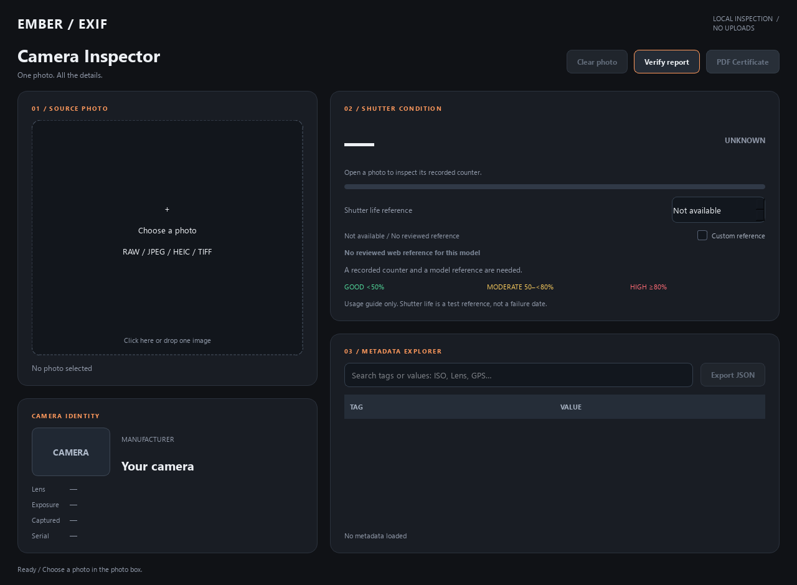
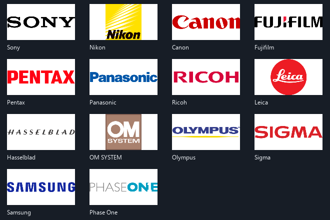

# EXIF Reader

**Your camera's details. Without uploading your photos.**

Application code written entirely by AI under the direction of **Jirawat Pratuangtip**. See the [disclaimer](#disclaimer).

A local, ad-free camera metadata inspector for Windows. Read EXIF and supported RAW metadata, inspect recorded shutter counts, and export PDF reports from a dark, orange-accented desktop interface. The application is also labeled **EMBER EXIF** inside the window.



## Downloads

Download [EXIFReader 1.0.0 for Windows x64](https://github.com/Jirawat2105/EXIF-Reader/releases/download/v1.0.0/EXIFReader-1.0.0-Windows-x64.exe) from [GitHub Releases](https://github.com/Jirawat2105/EXIF-Reader/releases).

Double-click the EXE to start. Python, ExifTool and the downloaded brand logos are included; no Python installation, setup script or internet connection is needed to inspect photos. The EXE is a portable single-file app, not an installer, and extracts its runtime to a temporary folder at startup. Allow a moment for the first launch.

[SHA-256 checksums](https://github.com/Jirawat2105/EXIF-Reader/releases/download/v1.0.0/SHA256SUMS.txt) and [third-party notices](https://github.com/Jirawat2105/EXIF-Reader/releases/download/v1.0.0/EXIFReader-1.0.0-ThirdPartyNotices.zip) accompany the release. GitHub source archives contain project files, not the compiled app.

The Windows executable is unsigned. Windows may display **Unknown Publisher** or a SmartScreen warning. That message alone is not a malware detection and does not establish safety; investigate specific threat detections before running any download. Source code is available for inspection and rebuilding.

## Features

- Click the photo box to select or replace one photo, or drop a single image into the window.
- Preview supported images, including embedded RAW previews, with orientation applied.
- Read camera, lens, exposure, capture time and serial information when available.
- Display original SVG brand logos downloaded from Wikimedia Commons for 14 camera brands; artwork and provenance are bundled for offline use.
- Inspect a recorded shutter counter and see which metadata tag supplied it.
- Match supported camera models to a shutter-life reference, with its source and provenance displayed.
- View green, yellow and red usage bands, or enter a clearly labeled custom reference.
- Search metadata tags and values, then export JSON.
- Create PDF reports with a metadata appendix, source SHA-256 and a companion verification record.
- Clear the current photo and its displayed data without deleting the original.
- Process photos locally without an account, ads or image uploads.

## Requirements

- Windows x64. The compiled EXE includes Python and ExifTool.
- Running from source instead requires 64-bit Python 3.11+ in PATH and internet access for initial dependency setup.
- Enough memory and disk space for the selected photo and exported reports.

macOS, Linux and mobile builds have not been validated. The current automatic ExifTool setup is for Windows x64.

## Run from source

1. Clone or download this repository and extract it to a folder of your choice.
2. Double-click **Launch EXIF Reader.bat**.
3. On first launch, setup creates a private `.venv`, installs Python dependencies and downloads ExifTool.
4. Click the photo box and select a photo.

The ExifTool download is pinned to version 13.59 and checked against a recorded SHA-256 before extraction. Its full upstream package and license files are kept under `tools/`. Keep that folder beside the app after setup. Later launches work offline once dependencies are installed. **View source** opens an external website only when selected.

Alternatively, run these commands from PowerShell in the repository folder:

```powershell
python -m venv .venv
.\.venv\Scripts\python.exe -m pip install -r requirements.txt
.\.venv\Scripts\python.exe scripts\install_exiftool.py
.\.venv\Scripts\python.exe main.py
```

The first dependency setup needs internet access. The application reads photo files without modifying them.

## Supported formats and limitations

ExifTool provides metadata support for formats including **ARW, NEF, NRW, CR2, CR3, CRW, RAF, RW2, ORF, PEF, DNG, SRW, IIQ, 3FR, X3F, JPEG, TIFF and HEIC**. Preview availability depends on the embedded preview and image decoder.

Metadata support does not mean every camera records a usable shutter counter. Some models require a camera connection or a service tool instead. Edited or shared images may have had metadata removed. The app does not substitute a filename or sequence number for a shutter count.

The interface handles one photo at a time. Folder loading, batch processing and batch CSV export are not included.

## Shutter-life references

The source catalog contains **42 model-specific references**, reviewed on **October 23, 2026**, across Nikon, Sony, Canon, Fujifilm, Pentax, OM SYSTEM and Panasonic. Exact model matching and explicit EXIF naming aliases avoid applying a rating from a different camera generation.

| Reference type | Meaning |
| --- | --- |
| Manufacturer tested | A durability reference published by the manufacturer. |
| Third-party estimate | A web estimate, distinguished from a manufacturer specification. |
| Manual reference | A value entered through **Custom reference**. |
| Not available | No reviewed matching reference; no rating is guessed. |
| Electronic shutter only | A mechanical shutter-life comparison does not apply. |

For example, the Sony A7 IV reference is a third-party estimate rather than a verified Sony durability specification. Each catalog entry includes its source link. The catalog is stored locally; the app does not perform a live web search for every photo. Models outside the catalog can still have their metadata read.

Usage bands are **GOOD below 50%**, **MODERATE from 50% to below 80%**, and **HIGH USAGE at 80% or more** of the reference. These are the app's usage bands, not a manufacturer condition grade or a prediction of remaining life. Counter meaning can vary by camera and shutter mode.

## PDF reports and verification

Select a photo and click **PDF Certificate**. The app saves:

- A PDF containing camera details, the recorded counter and its tag, reference provenance, issue time, report ID, source SHA-256 and a full metadata appendix.
- A `.certificate.json` companion containing the record and checksums.

Keep both files. **Verify report** compares the companion record, original photo and PDF checksums.

This is a local integrity comparison, **not a digital signature, public verification service, physical inspection or manufacturer certification**. Metadata can be edited, and someone who changes both a record and its checksums can create a new matching set. A changed source file must be reopened before issuing a report.

Photos are not uploaded. Exported metadata and reports can contain serial numbers, location or other information from the selected file; review their contents before sharing them.

## Repository layout

```text
main.py                   Desktop interface and background workers
metadata.py               Metadata extraction, preview reading and counters
ratings.py                Model references and provenance
reports.py                PDF reports and local checksum verification
scripts/                  Verified ExifTool setup helper
assets/logos/             Original SVG brand artwork and source manifest
brand_logos.py            Offline SVG logo renderer
self_test.py              Packaged-app smoke test
docs/                     Screenshot without personal photo data
test_*.py                 Automated checks
.github/workflows/        Windows test workflow
```

Virtual environments, downloaded tools, personal photos, generated reports and test outputs are excluded from Git. Compiled downloads belong in GitHub Releases rather than the source tree.

## Build the Windows EXE

Double-click **Build EXE.bat**, or run:

```powershell
.\.venv\Scripts\python.exe -m pip install -r requirements.txt pyinstaller==6.22.3
.\.venv\Scripts\python.exe scripts\build_windows.py
```

Build on Windows x64. The script bundles the complete ExifTool distribution, logo assets, Python/Qt runtime and license notices, then runs the frozen application from outside the checkout using the native Windows backend. The smoke test checks all logos, photo reading, automatic reference matching, PDF generation/checksums and Clear photo. Versioned release files and SHA-256 checksums are written to `dist/`.

## Brand logos

The app uses original SVG files downloaded from Wikimedia Commons, rather than recreating logos with installed fonts. The current collection covers Sony, Nikon, Canon, Fujifilm, Pentax, Panasonic, Ricoh, Leica, Hasselblad, OM SYSTEM, Olympus, Sigma, Samsung and Phase One. Original colors and proportions are retained on a neutral logo tile. Unknown brands use a plain text fallback.



File URLs, source pages, hashes, authors/credits and source license labels are recorded in [`assets/logos/SOURCES.json`](assets/logos/SOURCES.json). Logos and trademarks remain with their respective owners; MIT applies to the project code, not ownership of those marks. No manufacturer endorsement is implied.

To refresh the artwork from the recorded Commons file titles, run `python scripts/fetch_brand_logos.py` and review the resulting changes. Inspection never uploads photos or performs background logo requests.

## Testing

```powershell
.\.venv\Scripts\python.exe -m pip install -r requirements-dev.txt
.\.venv\Scripts\python.exe -m unittest -v
```

Tests cover counters and usage bands, exact reference matching, photo-box selection, clear during reading, replacement, cancelled dialogs, custom-reference restoration, PDF generation and provenance, source changes, checksum mismatches ExifTool archive validation, and the integrity/rendering of all 14 downloaded logos. GUI tests use Qt's offscreen backend.

Earlier local validation read 221 Sony ILCE-7M4 ARW images and 11 additional ExifTool project fixtures across several brands and formats. Those private images, reports and fixture outputs are not included in this repository. That validation does not establish support for every model or firmware version.

## Troubleshooting

- If setup cannot find Python, install 64-bit Python 3.11+ and enable its PATH option.
- If dependency installation fails, check the displayed error and internet connection.
- If RAW reading fails, run `scripts/install_exiftool.py` using the virtual environment's Python and retain the entire downloaded `tools/` package.
- A checksum mismatch stops ExifTool setup. Do not bypass it; check the download source before changing a pinned checksum.
- An unavailable preview does not necessarily mean metadata reading failed.
- An unknown counter or reference is left unknown rather than estimated from unrelated data.
- Check folder permissions and available disk space if exporting fails.

## Disclaimer

EXIF Reader's application code was written entirely by AI under the direction of **Jirawat Pratuangtip**. Third-party libraries are separate projects maintained by their respective authors.

AI-generated code may contain bugs or unexpected behavior. This software is provided "as is", without warranty, under the terms of the [MIT License](LICENSE). Keep backups of important images and verify displayed information and exported reports before relying on them.

Download source from [this repository](https://github.com/Jirawat2105/EXIF-Reader). Compiled Windows downloads are provided in Releases. The executable is not digitally signed.

## Built with

- Python
- PySide6 Essentials / Qt Widgets
- Pillow
- ExifTool, run as a separate process
- ReportLab
- pypdf for development tests

Third-party dependencies retain their own licenses. See [Third-party notices](THIRD_PARTY_NOTICES.md).

## Author

Project creator: **Jirawat Pratuangtip**. Application code written entirely by AI under their direction.

GitHub: [Jirawat2105](https://github.com/Jirawat2105)

Related projects: [PanoTess](https://github.com/Jirawat2105/PanoTess) and [QR Code Generator](https://github.com/Jirawat2105/QR-Code-Generator).

## License

Copyright (c) 2026 Jirawat Pratuangtip.

Project code is licensed under the [MIT License](LICENSE). Third-party dependencies retain their own licenses.
